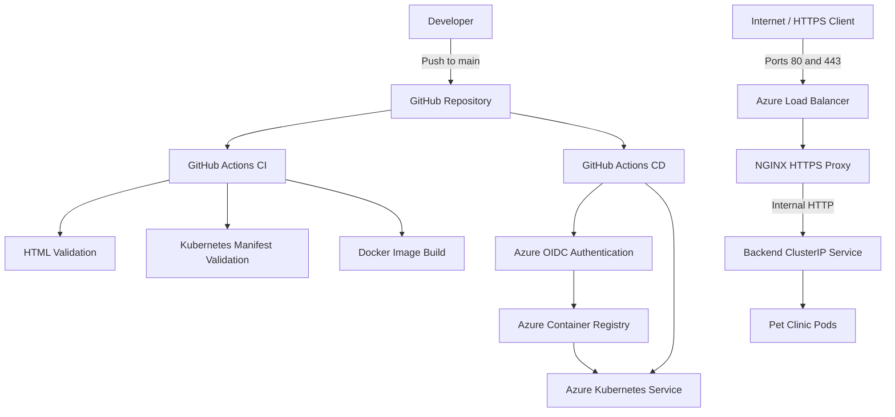
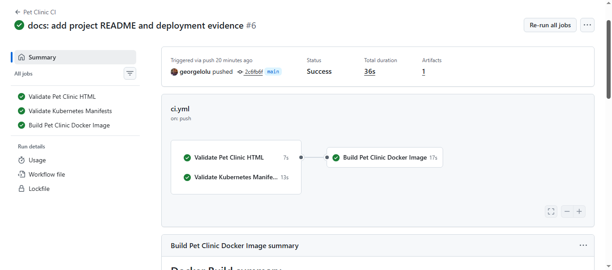
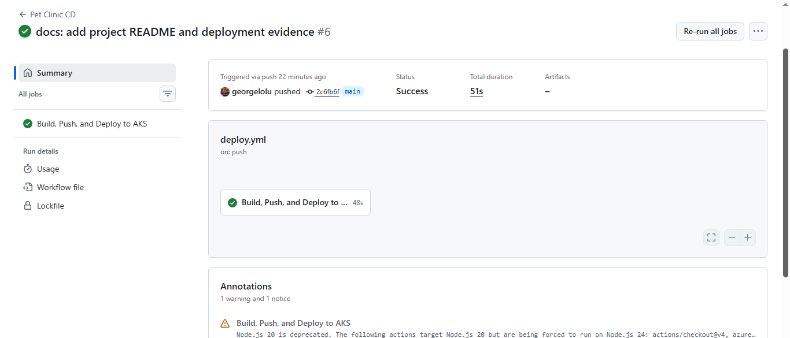

# Pet Clinic — Azure Kubernetes Service (AKS)

A containerized Pet Clinic website deployed to Microsoft Azure Kubernetes Service (AKS), with automated CI/CD using GitHub Actions, Azure Container Registry (ACR), Kubernetes, and HTTPS through an NGINX reverse proxy.

**Live website:** [https://57.167.3.11/](https://57.167.3.11/)

> **Portfolio project:** This project demonstrates practical cloud infrastructure, containerization, Kubernetes deployment, automated delivery, TLS configuration, and operational verification.

## Project Overview

The Pet Clinic project packages a static website into a Docker image, stores the image in Azure Container Registry, and deploys it to AKS. A separate NGINX reverse proxy terminates HTTPS and forwards requests to the application through an internal Kubernetes Service.

GitHub Actions automates code validation, Kubernetes manifest checks, Docker image building, and application deployment.

## Architecture



## Technology Stack

| Category | Technologies |
|---|---|
| Cloud platform | Microsoft Azure |
| Container orchestration | Azure Kubernetes Service (AKS) |
| Container registry | Azure Container Registry (ACR) |
| Containerization | Docker |
| Reverse proxy and web server | NGINX |
| CI/CD | GitHub Actions |
| Cloud authentication | Azure workload identity federation / OIDC |
| Application protocol | HTTP and HTTPS |
| TLS | Kubernetes TLS Secret and NGINX |
| Validation | Python HTML checks, PyYAML manifest checks, Docker image build |
| Infrastructure configuration | Kubernetes YAML manifests |

## Azure Environment

| Property | Value |
|---|---|
| Resource group | `pet-clinic-aks-rg` |
| AKS cluster | `pet-clinic-aks` |
| Azure region | `centralus` |
| Container registry | `petclinicacr3595.azurecr.io` |
| Image name | `pet-clinic` |
| Kubernetes public IP | `57.167.3.11` |
| Public service | `pet-clinic` |
| Application deployment | `pet-clinic` |
| HTTPS proxy deployment | `pet-clinic-proxy` |
| TLS Secret | `pet-clinic-tls` |

## Application and Kubernetes Design

The application is a static HTML website served from an NGINX-based Docker image.

The Kubernetes configuration includes:

- **Application Deployment:** runs two Pet Clinic replicas.
- **Proxy Deployment:** runs one NGINX reverse proxy replica.
- **Public LoadBalancer Service:** exposes ports 80 and 443.
- **Backend ClusterIP Service:** provides internal access to the application pods.
- **Proxy ClusterIP Service:** exposes the NGINX proxy internally.
- **TLS Secret:** supplies the certificate and private key to the proxy.
- **Proxy ConfigMap:** stores the NGINX routing and TLS configuration.

The intended request path is:

1. A visitor connects to the public IP over HTTP or HTTPS.
2. The LoadBalancer forwards traffic to the NGINX proxy.
3. NGINX handles TLS for HTTPS requests.
4. NGINX forwards application requests to the internal backend Service.
5. Kubernetes routes the request to an available application pod.

## CI/CD Pipeline

### Continuous Integration

Workflow: `.github/workflows/ci.yml`

Triggered by pushes and pull requests targeting `main`.

The workflow performs:

1. HTML content validation, including the page title, required sections, links, and service headings.
2. YAML parsing and structural validation of the Kubernetes manifests.
3. Checks for public service ports, the expected LoadBalancer IP, backend Service type, proxy ports, and TLS Secret mounting.
4. Docker image building without pushing the test image to a registry.

### Continuous Deployment

Workflow: `.github/workflows/deploy.yml`

Triggered by pushes to `main` and manual workflow dispatch.

The workflow:

1. Checks out the repository.
2. Authenticates to Azure using GitHub Actions and OIDC.
3. Logs in to Azure Container Registry.
4. Builds and pushes a Docker image tagged with the Git commit SHA.
5. Retrieves AKS credentials.
6. Updates the application Deployment image.
7. Waits for the application rollout and checks the Kubernetes resources.

The deployment workflow updates the application image; it does not automatically apply every Kubernetes manifest in `website/k8s/`.

## Repository Structure

```text
pet-clinic-aks/
├── .github/
│   └── workflows/
│       ├── ci.yml
│       └── deploy.yml
├── docs/
│   └── evidence/
│       ├── README.md
│       ├── 01-pet-clinic-live-website.png
│       ├── 02-pet-clinic-kubernetes-status.png
│       ├── 03-pet-clinic-azure-aks-cluster.png
│       └── 04-pet-clinic-acr-image.png
├── terraform/
├── website/
│   ├── Dockerfile
│   ├── index.html
│   └── k8s/
│       ├── deployment.yaml
│       ├── service.yaml
│       ├── backend-service.yaml
│       └── tls-proxy.yaml
└── README.md
```

The `terraform/` directory is currently empty. The Azure infrastructure described here was verified in the deployed environment; this repository does not currently contain Terraform configuration to recreate it.

## Deployment Verification

The following checks were completed during the deployment exercise:

| Check | Observed result |
|---|---|
| Pet Clinic CI workflow | Passed |
| Pet Clinic CD workflow | Passed |
| Application Deployment | 2/2 replicas ready |
| NGINX proxy Deployment | 1/1 replica ready |
| Application pods | Running and ready |
| Proxy pod | Running and ready |
| Public LoadBalancer IP | `57.167.3.11` |
| Public service ports | 80 and 443 |
| HTTPS HTTP status | `200` |
| TLS verification result | `0` |

These results describe the environment at the time of verification. Cloud resources and certificates can change after evidence is captured.

## Portfolio Evidence

Screenshots and supporting details are available in [`docs/evidence/`](docs/evidence/README.md).

| Evidence | Description |
|---|---|
| [Live website](docs/evidence/01-pet-clinic-live-website.png) | Browser view of the deployed Pet Clinic website |
| [Kubernetes status](docs/evidence/02-pet-clinic-kubernetes-status.png) | Application workloads and Service status |
| [Azure AKS cluster](docs/evidence/03-pet-clinic-azure-aks-cluster.png) | Azure Kubernetes Service environment |
| [ACR image](docs/evidence/04-pet-clinic-acr-image.png) | Container image in Azure Container Registry |
| [CI success](docs/evidence/05-pet-clinic-ci-success.png) | Successful GitHub Actions continuous integration run |
| [CD success](docs/evidence/06-pet-clinic-cd-success.png) | Successful GitHub Actions continuous deployment run |

### CI/CD Pipeline Screenshots

#### Continuous Integration (CI)



#### Continuous Deployment (CD)



## Reproducing the Verification Checks

Prerequisites include the Azure CLI, `kubectl`, Git, Docker, and access to the relevant Azure subscription and GitHub repository.

### Check Kubernetes workloads

```bash
az aks get-credentials \
  --resource-group pet-clinic-aks-rg \
  --name pet-clinic-aks \
  --overwrite-existing

kubectl get deployments
kubectl get pods -o wide
kubectl get services
```

### Check the live HTTPS endpoint

```bash
curl -sS -o /dev/null \
  -w 'HTTPS status: %{http_code}\nTLS verification result: %{ssl_verify_result}\n' \
  https://57.167.3.11/
```

A successful response at the time of verification returned HTTP `200` and TLS verification result `0`.

## Security and Cost Considerations

- GitHub Actions uses OIDC for Azure authentication rather than storing a long-lived Azure client secret in GitHub.
- Review Azure role assignments and AKS access permissions regularly; use least-privilege permissions appropriate to the deployment.
- Keep TLS private keys and credentials out of source control.
- Monitor TLS certificate expiry. The certificate used during this exercise was reported valid through **20 October 2026**; verify its current validity before relying on the endpoint.
- AKS nodes, load balancers, public IP addresses, container registries, and related resources can incur Azure charges.
- When the project is no longer needed, plan resource cleanup carefully and verify which resources will be deleted before running destructive commands.

## Skills Demonstrated

- Azure cloud deployment
- Docker image creation
- Kubernetes Deployments, Pods, and Services
- Azure Container Registry
- GitHub Actions CI/CD
- Azure OIDC authentication
- NGINX reverse proxy configuration
- TLS certificate integration
- Automated HTML and manifest validation
- Deployment health checks and operational documentation

---

**Repository:** [georgelolu/pet-clinic-aks](https://github.com/georgelolu/pet-clinic-aks)
